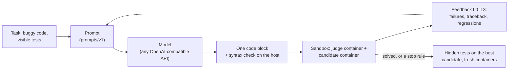

# PatchLoop

[](https://github.com/keshavm21/patchloop/actions/workflows/ci.yml)

A sandboxed, self-repairing coding agent, and a harness that measures it. An LLM fixes buggy Python functions by running the visible tests in a locked-down Docker sandbox, reading the failures and patching, until the tests pass or a stop rule fires. Hidden tests the model never sees give the verdict. Every number below comes from a frozen benchmark, a config file and a commit.

<!-- RESULTS -->
## Results

Test splits, repair rate = share of tasks whose **hidden** tests pass, with 95% bootstrap intervals over tasks ([full report](results/REPORT.md)).

| Benchmark (model) | Tasks × repeats | Single shot | Repair loop (3 attempts, test feedback) | Difference, points |
|---|---|---|---|---|
| MutBench, bugs new to the model (`openai/gpt-oss-20b`) | 150 × 1 | 83.3 [77.3, 89.3] | 86.7 [81.3, 92.0] | **+3.3 [+0.7, +6.7]** |
| MutBench (`qwen/qwen3.8-27b`) | 150 × 1 | 81.3 [75.3, 87.3] | 89.3 [84.0, 94.0] | **+8.0 [+4.0, +12.7]** |
| HumanEvalFix, public and likely memorised (`openai/gpt-oss-20b`) | 121 × 2 | 96.7 [93.4, 99.2] | 97.9 [95.0, 100.0] | +1.2 [+0.0, +3.3] |

- **Where the model can't recall the answer.** MutBench: `full` better for the main model, `full` better for the second. HumanEvalFix: the model already solves 96.7% in one shot (no clear difference).
- **How the loop gains.** Of the main model's 5 extra MutBench solves, 5 were wrong answers fixed after seeing a failing test. Of the second model's 12, 10 were malformed replies that a second attempt recovered.
- **Why the rest fail.** In 32 hand-labelled failures: wrong diagnosis (12), partial fixes (9), benchmark noise where the reference contradicts its own spec (7), and over-defensive validation (3). There was no case of hard-coding the visible tests.
<!-- /RESULTS -->

## How it works



1. Build the prompt: the task, the current code, the visible tests, a one-line summary of each earlier attempt, and full feedback on the latest one.
2. Ask the model for the whole corrected file in one code block, and check its syntax on the host. Nothing the model writes ever runs on the host.
3. Run the visible tests in the sandbox and classify the result (`PASSED`, `TESTS_FAILED`, `RUNTIME_ERROR`, `TIMEOUT`, `OOM`, …).
4. Stop on success, after 3 attempts, on no progress (repeated code or a repeated error), or when the token or time budget runs out. Otherwise render the failures as feedback and go again.
5. Judge the best candidate (the most visible tests passed) against the hidden tests, in fresh containers.

The loop is about 200 lines of plain Python with no agent framework ([`agent/loop.py`](src/patchloop/agent/loop.py)). [docs/architecture.md](docs/architecture.md) has diagrams of the system, a sandbox run and the status rules.

## Sandbox

Every run uses **two fresh containers**. A judge runs pytest and the tests. A second container runs the candidate's code and answers the judge's function calls over a Unix socket that carries only plain data (numbers, strings, lists, dicts). The candidate can't read or change the tests, can't touch pytest, and can't forge the report. It can only return wrong answers.

| Control | Setting |
|---|---|
| Network | none, in both containers |
| Memory | 512 MB, no swap |
| CPU and processes | 1 CPU, at most 64 processes |
| Filesystem | read-only root; a 64 MB `/tmp` is the only writable path (no `/dev/shm`) |
| User | uid 10001, all capabilities dropped, `no-new-privileges` |
| Time | a per-test timeout, plus a host-side kill at the wall-clock limit |
| Environment | 3–4 fixed variables; API keys never enter |
| Lifetime | fresh containers and volume per run, always removed |

The **chaos suite** (`make chaos`, run in CI) throws hostile code at the sandbox and checks that each attack is contained: infinite loops, a 4 GiB memory blowup, a fork bomb, network egress over IPv4 and IPv6, DNS and UDP, secret hunting with a planted canary key, writes outside `/tmp`, test tampering, disk fill, output floods, lingering processes, and fake success. Building it turned up two ways a candidate could fake `PASSED` in a single-container design, by planting a JUnit report or by writing fake results to the runner's stdout. The two-container judge closes both, and both are now regression tests.

A trivial passing run costs 0.60 s at the median and 0.77 s at p95, from container creation to removal ([`results/sandbox_overhead_arm64.json`](results/sandbox_overhead_arm64.json), Apple Silicon, Docker Desktop).

## Benchmarks and method

| Benchmark | Tasks (dev / test) | Bugs | Visible tests | Hidden tests |
|---|---|---|---|---|
| **HumanEvalFix** (Python subset of `bigcode/humanevalpack`) | 162 (41 / 121) | human-written, 6 bug types | the docstring examples | the full test suite |
| **MutBench** (built here from `evalplus/mbppplus`) | 200 (50 / 150) | 7 AST mutation operators | MBPP's 3 asserts | EvalPlus's extended inputs |

- **Validated before freezing.** Every task's reference solution passes both test sets in the sandbox, and its buggy version fails at least one hidden test; tasks that fail a check are dropped and logged. Datasets are pinned to a revision, downloaded and built locally, and never re-hosted. Only manifests with every file's checksum are committed, and setup refuses a rebuild that doesn't match.
- **MutBench** samples 3 mutants per problem from 7 operators, keeps a mutant only if the hidden tests catch it, labels its symptom (wrong output, crash or hang), and balances 200 tasks across operators, at most 2 per problem. Its bugs are new even though the problems are public, which limits contamination.
- **Splits and rigor.** 25% of each benchmark is a dev split, stratified with a fixed seed. The prompts (v1) and model settings were fixed using dev runs only, before any test run, and the results are on test. Each config runs 3 times. A task's solve rate is averaged over its repeats, and configs are compared with a paired bootstrap over tasks (95% intervals). An interval that includes zero is reported as "no clear difference".
- **Infra errors aren't agent failures.** Rate limits, outages and Docker failures are retried, quarantined and reported separately.

## Design decisions

- **Two containers for the judge.** A single container is simpler, but there the candidate shares a process and a user with pytest and can forge its own report. The cost is about 0.25 s per run and a plain-data boundary: functions must take and return plain values, so three MBPP problems that return `re.Match` objects were dropped.
- **Whole-file replacement, not diffs.** Files are small, so asking for the complete file is the simplest edit format and fails in obvious ways.
- **A plain state machine, no framework.** The loop is the thing under study, so it stays small enough to read in one sitting.
- **Feedback level is an experiment variable.** L0 (nothing), L1 (pass/fail counts), L2 (failing tests and exceptions) and L3 (tracebacks, expected vs actual, printed output, regression notes) are separate configs, so their effect is measured rather than assumed.
- **Replies are cached by (model, messages, parameters, repeat).** The repeat index keeps repeats independent. Configs whose first prompt is identical share attempt 1 through the cache, which pairs the comparison and saves quota.
- **Free-tier friendly.** The runner resumes where it stopped, honours `Retry-After`, keeps rate-limit waits out of the agent's time budget, and stops itself after repeated infra errors, so a daily quota only delays a run.

## Limitations

- Function-level Python only; real bugs often span files and need code navigation.
- Tests are a proxy for correctness. Hidden tests shrink false passes but don't remove them, and in 13 of MutBench's 200 tasks the visible tests can't see the bug at all.
- HumanEvalFix is public and likely in the model's training data. MutBench's bugs are new, but its problems are public too.
- Docker shares the host kernel; gVisor or Firecracker would be the next step for running untrusted code from strangers.
- Groq's free tier isn't deterministic at temperature 0, and the numbers hold for this model and prompt version only.

## Reproduce

Requires Python 3.11+ and Docker.

```bash
python3.12 -m venv .venv && source .venv/bin/activate
pip install -e ".[dev]"
make sandbox-image          # build the sandbox image
make test                   # unit tests, no Docker needed
make chaos                  # the sandbox and chaos suite against real Docker
make demo                   # the loop on a recorded model reply: no API key needed
```

With a model key in `.env` (`GROQ_API_KEY` for the configs here, or any OpenAI-compatible endpoint):

```bash
patchloop solve benchmarks/examples/second_largest.json --config configs/full.yaml
patchloop replay runs/<date>/<task>/<run>/      # step through a finished run, with code diffs

export HF_HOME=$PWD/.cache/hf
python -m patchloop.bench.setup humanevalfix     # download, build, verify against the manifest
python -m patchloop.bench.setup mutbench
patchloop eval --bench mutbench --split test --repeats 3 \
  --config configs/single_shot.yaml --config configs/full.yaml
patchloop report results/mutbench-test
```

The Docker SDK reads `DOCKER_HOST`, not the docker CLI's context. On Colima, set `export DOCKER_HOST="$(docker context inspect --format '{{.Endpoints.docker.Host}}')"` first, and check that `python -c "import docker; print(docker.from_env().ping())"` prints `True`.
