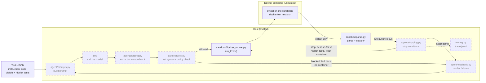
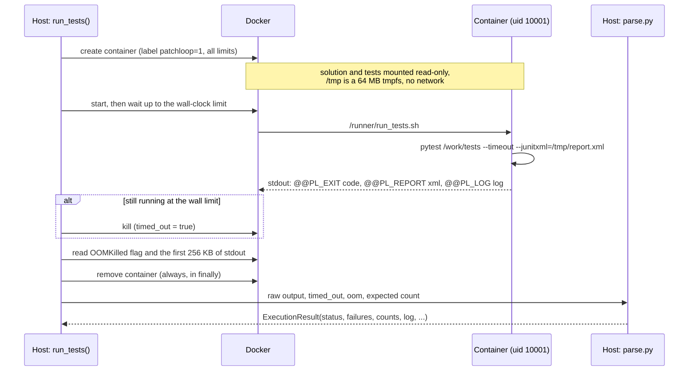
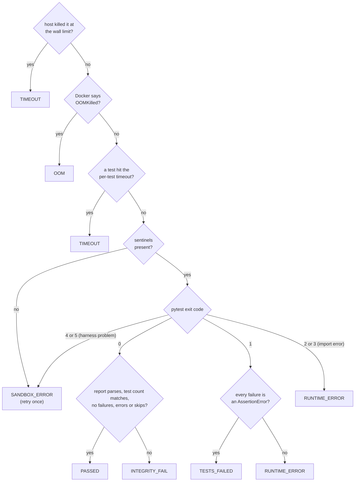

# Architecture

PatchLoop repairs buggy Python functions. A model proposes a fix, the fix runs against visible tests in a locked-down Docker container, the failures are fed back, and the loop repeats until the tests pass or a stop condition fires. Hidden tests, which the model never sees, give the final verdict.

This page covers what is built so far (the sandbox) and how it fits into the planned system.

## The whole system

Solid boxes are built; dashed boxes are planned.



## One sandbox run

`run_tests(solution_dir, tests_dir, expected_tests)` runs one candidate in a fresh container and returns a typed `ExecutionResult`.



Results leave the container only on stdout, between sentinel lines printed by the trusted runner script. That is why the container needs no writable host mount. Everything the container prints is treated as untrusted. The JUnit report is parsed with `defusedxml`, and every string kept from it is length-capped.

If the run comes back as `SANDBOX_ERROR`, it is retried once. If the retry fails the same way on the same code, it becomes `INTEGRITY_FAIL`. If Docker itself fails (daemon down, image missing, API error), `SandboxInfraError` is raised so that the failure is never blamed on the candidate.

## Status classification

The first matching rule wins:



`SYNTAX_ERROR`, `POLICY_BLOCKED` and `PARSE_FAILED` are decided on the host before any container starts, once those stages exist.

## Container controls

| Control | Setting | Stops |
|---|---|---|
| No network | `network_mode="none"` | Exfiltration, downloads |
| No shared memory | `ipc_mode="none"` (no `/dev/shm`) | A second writable path |
| Memory, no swap | 512 MB, swap limit equal | Memory blowups |
| CPU | 1 CPU | Starving other runs |
| Processes | `pids_limit=64` | Fork bombs |
| Time | per-test `pytest-timeout`, plus a host kill at 30 s | Infinite loops, hangs |
| Filesystem | read-only root, 64 MB `/tmp` tmpfs, inputs mounted read-only | Persistence, disk filling, test tampering |
| User | uid 10001, all capabilities dropped, `no-new-privileges` | Privilege escalation |
| Environment | only `PYTHONPATH`, `HOME=/tmp`, `PYTHONDONTWRITEBYTECODE`, `PER_TEST_TIMEOUT` | Secret leakage |
| Output | Docker log capped at 1 MB; host reads 256 KB; log kept to 20k characters | Log floods |
| Lifetime | a fresh container per run, always removed | State leaking between runs |
| Image | `python:3.12-slim` pinned by digest, hash-locked packages | Drift |

## The chaos suite

`make chaos` runs 11 hostile fixtures from `tests/sandbox/cases/chaos/` against real Docker, with no model involved, and checks that each one is contained. The fixtures run only inside the container. Host-side pytest never collects them.

| Scenario | What the fixture does | Checked outcome |
|---|---|---|
| Infinite loop | spins forever after disabling pytest-timeout's alarm | `TIMEOUT` from the host kill, within the limit plus 5 s |
| Memory blowup | touches 4 GiB | `OOM` (or `MemoryError`); Docker still responds |
| Process storm | forks without cleaning up | fewer than 64 children; the run ends cleanly |
| Network egress | TCP over IPv4 and IPv6, DNS, UDP, `host.docker.internal` | every attempt fails; no routes except loopback |
| Secret hunting | dumps the environment, `/proc/*/environ`, home, `/etc/shadow`, the Docker socket | a canary key set on the host never appears; only the expected variables |
| Writes outside `/tmp` | writes to the mounts, `/`, `/etc`, site-packages, `/dev/shm`, … | all fail; `/tmp` works |
| Test tampering | rewrites, deletes or shadows the tests at import | blocked; test file hashes unchanged; all tests still run |
| Disk fill | writes until it can't | stops at 64 MB; leaving `/tmp` full can't pass |
| Output flood | prints about 15 MB | log truncated to the cap |
| Lingering process | leaves a detached background process | container removed; the next run starts clean |
| Fake success | `os._exit(0)` or `sys.exit(0)` at import | `INTEGRITY_FAIL` or `RUNTIME_ERROR`, never `PASSED` |

`tests/sandbox/test_runner.py` also checks every status against benign variants of one small task. Every sandbox test asserts that no `patchloop`-labelled container is left behind.

## Known limitation: report forging

The tests and the candidate run in the same process, as the same user, so a deliberately hostile candidate can forge its own result. For example, it can write a fake `/tmp/report.xml` and then call `os._exit(0)`, or print fake sentinel lines on the runner's stdout. The static policy check will block the obvious forms, but it can be bypassed. The fix is a judge that calls the solution from a separate process and compares outputs itself. It is planned but not built yet.

## Code map (built so far)

```
docker/
  sandbox.Dockerfile         pinned image, non-root user
  sandbox-requirements.txt   hash-locked pytest, pytest-timeout, numpy
  run_tests.sh               trusted runner: runs pytest, prints the sentinel sections
src/patchloop/
  models.py                  Status, FailedTest, ExecutionResult
  sandbox/limits.py          resource limits (never loosened to make a run pass)
  sandbox/docker_runner.py   run_tests(), SandboxInfraError, retry on SANDBOX_ERROR
  sandbox/parse.py           sentinel splitting, defusedxml JUnit parsing, classification
  sandbox/overhead.py        measures per-run overhead into results/
tests/unit/                  parser and classifier tests, no Docker
tests/sandbox/               real-Docker status tests and the chaos suite
results/                     committed measurements (sandbox overhead)
```
