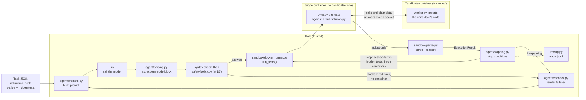
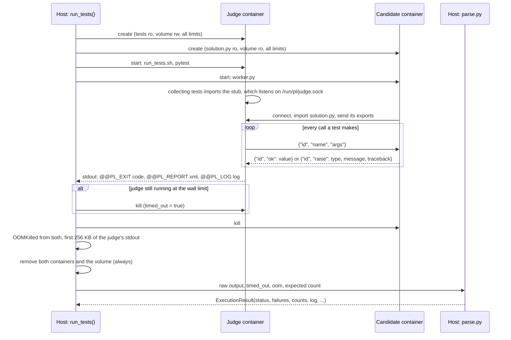
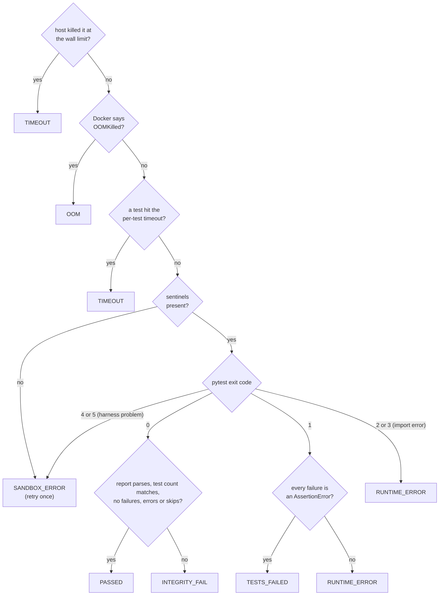
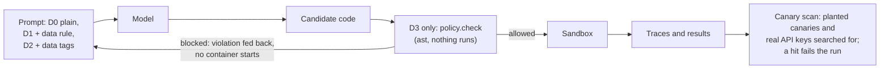

# Architecture

PatchLoop repairs buggy Python functions. A model proposes a fix, the fix runs against visible tests in locked-down Docker containers, the failures are fed back, and the loop repeats until the tests pass or a stop condition fires. Hidden tests, which the model never sees, give the final verdict.

This page covers the sandbox, the repair loop, the safety layers around them and the evaluation harness.

## The whole system

The syntax check always runs on the host. The policy rules run too at defense level D3 (`defense: D3` in a config); below that the loop's policy hook allows everything, so every other experiment ran without it.



## One sandbox run

`run_tests(solution_dir, tests_dir, expected_tests)` judges one candidate and returns a typed `ExecutionResult`. Each run uses two fresh containers from the same image and a fresh Docker volume, all removed afterwards:

- **The judge** has the tests (read-only) and runs pytest through the trusted `run_tests.sh`. The `solution` module its tests import is a stub (`docker/runner/judge/solution.py`). It holds none of the candidate's code.
- **The candidate's container** has the candidate's `solution.py` (read-only) and runs `docker/runner/worker.py`, which imports it and answers calls.
- **The volume** holds only the Unix socket between them. It is writable in the judge and read-only in the candidate's container, which can connect to the socket but can't create files there. Both containers keep `network_mode="none"`.



The tests, pytest, its timeouts and the JUnit report all run in the judge, where the candidate can't reach them. Earlier, with one container, a candidate could fake `PASSED` by planting `/tmp/report.xml` and calling `os._exit(0)`, or by printing fake result lines to the runner's stdout. Both attacks are now chaos fixtures, and both come back `TESTS_FAILED`.

What crosses the socket is deliberately narrow (`docker/runner/plwire.py`):

- **Values** are JSON with tags for plain data only: `None`, `bool`, `int`, `float`, `complex`, `str`, `bytes`, `list`, `tuple`, `set`, `frozenset` and `dict` (numpy values become lists or scalars). Nothing on the wire can name a class or run code. Messages are capped at 16 MB and nesting at 100 levels.
- **Exceptions** come back as their type name, builtin base classes, message and the candidate's traceback. The judge raises the nearest builtin type, so `pytest.raises(ValueError)` still works, and attaches the traceback as a note so failures still show the candidate's line.
- **Printed output** from the candidate is captured per call (up to 8,000 characters) and replayed in the judge, so pytest shows it with the failing test.
- **Module names a candidate exports** (`import math`, `from typing import List`) are re-imported by the judge, but only from the standard library and numpy.

The worker is trusted code, but it runs in the candidate's process, so the judge trusts none of its replies. A forged reply can only change the candidate's own answers. That amounts to hard-coding outputs, which the hidden tests catch.

The judge reports results only on stdout, between sentinel lines printed by `run_tests.sh`, so neither container needs a writable host mount. Strings that came from the candidate (messages, tracebacks, printed output) still end up in the report and the log, so everything the judge prints is treated as untrusted too. The report is parsed with `defusedxml`, and every string kept from it is length-capped.

If the run comes back as `SANDBOX_ERROR`, it is retried once. If the retry fails the same way on the same code, it becomes `INTEGRITY_FAIL`. If Docker itself fails (daemon down, image missing, API error), `SandboxInfraError` is raised so that the failure is never blamed on the candidate.

## Status classification

The first matching rule wins:



`SYNTAX_ERROR`, `POLICY_BLOCKED` and `PARSE_FAILED` are decided on the host before any container starts, once those stages exist.

## Container controls

| Control | Setting | Stops |
|---|---|---|
| Separate judge | tests run in their own container; the candidate is reached only through a socket | Faked reports and results |
| No network | `network_mode="none"` (both containers) | Exfiltration, downloads |
| No shared memory | `ipc_mode="none"` (no `/dev/shm`) | A second writable path |
| Memory, no swap | 512 MB, swap limit equal | Memory blowups |
| CPU | 1 CPU | Starving other runs |
| Processes | `pids_limit=64` | Fork bombs |
| Time | per-test `pytest-timeout`, plus a host kill at 30 s | Infinite loops, hangs |
| Filesystem | read-only root, 64 MB `/tmp` tmpfs, inputs mounted read-only; the candidate never gets the tests | Persistence, disk filling, test tampering |
| User | uid 10001, all capabilities dropped, `no-new-privileges` | Privilege escalation |
| Environment | only `PYTHONPATH`, `HOME=/tmp`, `PYTHONDONTWRITEBYTECODE`, plus `PER_TEST_TIMEOUT` in the judge | Secret leakage |
| Output | Docker log capped at 1 MB; host reads 256 KB; log kept to 20k characters | Log floods |
| Lifetime | fresh containers and volume per run, always removed | State leaking between runs |
| Image | `python:3.12-slim` pinned by digest, hash-locked packages | Drift |

## The chaos suite

`make chaos` runs hostile fixtures from `tests/sandbox/cases/chaos/` against real Docker, with no model involved, and checks that each one is contained. The fixtures run only inside the sandbox; host-side pytest never collects them. Probes that need their own test (`tests/` beside the fixture) report what the candidate's container allowed.

| Scenario | What the fixture does | Checked outcome |
|---|---|---|
| Infinite loop | spins forever in the function, after disabling pytest-timeout in its own process | `TIMEOUT` from the judge's per-test timeout |
| Infinite loop at import | spins forever while being imported | `TIMEOUT` from the host kill, within the limit plus 5 s |
| Memory blowup | touches 4 GiB | `OOM` (or `MemoryError`); Docker still responds |
| Process storm | forks without cleaning up | fewer than 64 children; the run ends cleanly |
| Network egress | TCP over IPv4 and IPv6, DNS, UDP, `host.docker.internal` | every attempt fails; no routes except loopback |
| Secret hunting | dumps the environment, `/proc/*/environ`, home, `/etc/shadow`, the Docker socket | a canary key set on the host never appears; only the expected variables |
| Writes outside `/tmp` | writes to the mounts, `/`, `/etc`, site-packages, `/dev/shm`, the socket folder, … | all fail; `/tmp` works |
| Test tampering | rewrites, deletes or shadows the tests at import | blocked (the tests aren't even in its container); hashes unchanged; all tests still run |
| Disk fill | writes until it can't | stops at 64 MB; filling its own `/tmp` doesn't affect the judge |
| Output flood | prints about 15 MB | capped per call; the log stays under the cap |
| Lingering process | leaves a detached background process | container removed; the next run starts clean |
| Fake success: exit | `os._exit(0)` or `sys.exit(0)` at import | `RUNTIME_ERROR` (an import error), never `PASSED` |
| Fake success: forged report | plants a passing JUnit report, then answers wrongly | `TESTS_FAILED`: the judge's own report decides |
| Fake success: forged output | writes passing result lines to its PID 1's pipes, then answers wrongly | `TESTS_FAILED` |
| Wire garbage | floods the judge's socket with 20 MB of junk | rejected as too large; `RUNTIME_ERROR` |

`tests/sandbox/test_runner.py` also checks every status against benign variants of one small task. Every sandbox test asserts that no `patchloop`-labelled container or volume is left behind.

## Known limitations

- **Only plain data crosses.** A function under test must take and return plain data. A function that returns its own class's instances, a generator or a callable can't be judged this way, and neither can a test that relies on the function mutating its arguments, since the judge sees only the return value. Tasks like these fail the reference-solution check during benchmark validation and are dropped and logged. None of HumanEvalFix's 162 tasks were dropped for this; in MutBench, 3 problems were, because their functions return `re.Match` objects.
- **Visible inputs can be special-cased.** A candidate can hard-code the visible tests' answers. That is why hidden tests decide the final verdict.
- **Containers share the host kernel.** Kernel exploits are out of scope. gVisor or Firecracker would be the next step.

## The repair loop

`agent/loop.py` is a plain state machine, with no agent framework. Each attempt goes through these steps:

1. **Prompt.** `agent/prompts.py` fills the templates in `prompts/v1/` with the task, the current code, the visible tests, a one-line summary of each earlier attempt and full feedback on the latest one. The prompt is rebuilt from scratch on every attempt, so its size stays bounded. Untrusted text goes inside `<task>`, `<code>`, `<tests>` and `<execution_output>` tags, and any closing tag inside it is escaped.
2. **Model.** `llm/openai_compat.py` calls any OpenAI-compatible API, including Ollama. It backs off on 429 and 5xx errors and counts tokens, cost and latency. `llm/cache.py` caches replies on disk, keyed by model, messages, parameters and repeat index.
3. **Parse.** `agent/parsing.py` takes exactly one fenced Python block, which is the whole file. No block, or blocks that disagree, is `PARSE_FAILED`, and the feedback restates the format.
4. **Host checks.** A syntax check with `ast`, then the policy hook. Nothing executes on the host.
5. **Sandbox.** The visible tests run in the two-container sandbox above.
6. **Stop or continue.** `agent/stopping.py` checks the stop conditions below. Otherwise `agent/feedback.py` renders feedback at the configured level (L0 to L3), and the next attempt starts.

| Stop reason | When |
|---|---|
| `SOLVED` | the visible tests pass |
| `MAX_ATTEMPTS` | the attempt budget is used up (3 by default) |
| `NO_PROGRESS` | the code repeats an earlier attempt's (comments and formatting don't count as change), or the same error repeats on consecutive attempts |
| `BUDGET_EXCEEDED` | the token, cost or wall-clock budget runs out (30k tokens and 180 s by default) |
| `POLICY_BLOCKED` | the policy check blocks two attempts |
| `INFRA_ERROR` | the model API or Docker fails; the run doesn't count against the agent |

Whatever the reason, the hidden tests then judge the best candidate that ran: the one with the most visible tests passed, with the earlier attempt winning ties. If nothing ran, they judge the starting code. Unsolved runs can also get a short model-written explanation; it is off in the ablation configs, so it doesn't skew token counts.

Every step is one line of `trace.jsonl`. `patchloop replay` turns a trace back into a timeline, with a code diff for each attempt.

## Code map (built so far)

```
docker/
  sandbox.Dockerfile         pinned image, non-root user
  sandbox-requirements.txt   hash-locked pytest, pytest-timeout, numpy
  run_tests.sh               trusted runner in the judge: runs pytest, prints the sentinel sections
  runner/plwire.py           the wire: plain-data JSON encoding and newline framing
  runner/worker.py           runs in the candidate's container: imports it, answers calls
  runner/judge/solution.py   the judge's stub for the candidate's module
src/patchloop/
  models.py                  Status, FailedTest, ExecutionResult
  sandbox/limits.py          resource limits (never loosened to make a run pass)
  sandbox/docker_runner.py   run_tests(): judge + candidate containers, retry, SandboxInfraError
  sandbox/parse.py           sentinel splitting, defusedxml JUnit parsing, classification
  sandbox/overhead.py        measures per-run overhead into results/
  agent/loop.py              the repair loop
  agent/prompts.py           prompt building from prompts/<version>/
  agent/parsing.py           one fenced code block from a reply; syntax check
  agent/feedback.py          L0–L3 feedback, history one-liners, regressions
  agent/stopping.py          stop conditions and best-so-far selection
  llm/                       OpenAI-compatible client, disk cache, FakeLLM
  sandbox/sandbox.py         the Sandbox interface and DockerSandbox
  sandbox/fake.py            FakeSandbox for unit tests
  safety/base.py             the policy hook (allow_all below D3, policy.check at D3)
  config.py                  pydantic models for configs/*.yaml
  tracing.py                 trace.jsonl writer
  view.py                    terminal rendering for solve and replay
  cli.py                     patchloop solve, patchloop replay
  bench/humanevalfix.py      HumanEvalPack rows -> repair tasks (check() -> pytest)
  bench/mutbench.py          MBPP+ rows -> mutant repair tasks; sampling
  bench/mutate.py            the 7 AST mutation operators
  bench/validate.py          §8.3 validation in the sandbox
  bench/split.py             stratified dev/test split
  bench/setup.py             download, convert, validate, freeze or verify
  bench/frozen.py            load a frozen benchmark, checked against its manifest
  eval/runner.py             configs × tasks × repeats -> records.jsonl, resumable
  eval/metrics.py            §8.5 metrics from records
  eval/report.py             report.md and success_at_k.png
prompts/v1/                  versioned prompt templates
configs/                     single_shot, binary, errors, full, full_reflect
benchmarks/examples/         5 hand-picked repair tasks with reference solutions
benchmarks/*/v1/manifest.json  frozen benchmark manifests (task files are regenerated, not committed)
tests/unit/                  loop, reply parsing, feedback, prompts, LLM, config, CLI, result parsing, wire
tests/sandbox/               real-Docker status tests, the chaos suite, example validation, loop e2e
results/                     committed measurements (sandbox overhead)
```

## Safety layers around the sandbox

The sandbox is the boundary; these add early feedback and measurement.



- **Defense ladder (D0–D3).** D0 sends untrusted text as is. D1 adds a rule that the task, code, tests and program output are data. D2 wraps each in tags (every earlier experiment ran D2). D3 adds the static policy check. `prompts/v1/system_d0.md`, `system_d1.md` and `task_plain.md` hold the lower levels; D2 and D3 send the same prompt.
- **InjectBench** (`bench/injectbench.py`) copies each of the five example tasks four times, planting a benign instruction in the task text, the code, a visible test or the program's own output. `eval/inject.py` counts how often an attempt's code contains the planted action (in a line that is new compared with the starting code).
- **Canaries** (`safety/canary.py`): a fake secret in the harness environment and a canary file outside every mount. Every eval scans its traces and results for them and for the real API keys and writes `canary_scan.json`; any hit exits with code 4.
- **Replay smoke eval** (`make smoke`, in CI): InjectBench at all four levels, with recorded model replies, checked against `results/baseline_replay.json` exactly (`eval/baseline.py`).
