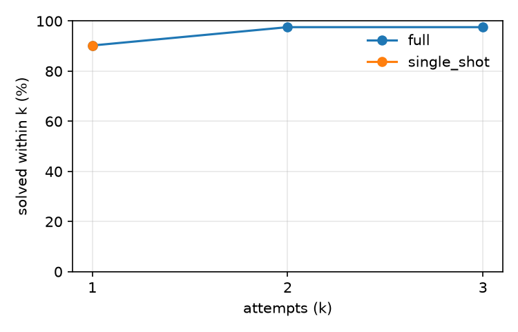

# humanevalfix (dev split)

Model `openai/gpt-oss-20b` at temperature 0.0, prompts `v1`, git `c82c11bc35` (with uncommitted changes), sandbox image `853c1b6a2156`, dataset checksum `72577208b630`, arm64.

Generated by `patchloop report` from `records.jsonl`. Infra errors are excluded from every rate below and counted separately. Configs whose first prompt is identical (at temperature 0) share attempt 1 through the response cache, which pairs them; cached calls keep their recorded tokens but take no time, so compare times with that in mind.

## Results

Repair % is the mean over tasks of each task's solve rate across its repeats, with a 95% bootstrap interval over tasks.

| Config | Tasks × repeats | Repair % [95% CI] | Overfit % | Attempts to success | Tokens / task | Cost / task | Time / task | Model time / task | Rate-limit wait / task | Cached calls |
|---|---|---|---|---|---|---|---|---|---|---|
| `full` | 41 × 1 | 97.6 [92.7, 100.0] | 2.4 | 1.00 | 806 | unknown | 1.8 s | 0.8 s | 0.0 s | 100.0% |
| `single_shot` | 41 × 1 | 97.6 [92.7, 100.0] | 2.4 | 1.00 | 806 | unknown | 5.3 s | 0.8 s | 2.9 s | 0.0% |

## Comparisons

Paired over the tasks both configs finished: the difference in per-task solve rate (b − a, in points) with a 95% bootstrap interval. An interval that includes zero is reported as no clear difference.

| a | b | Tasks | b − a [95% CI] | Verdict |
|---|---|---|---|---|
| `single_shot` | `full` | 41 | +0.0 [+0.0, +0.0] | no clear difference |

## Success@k

Share of runs whose hidden tests pass with the code from attempt k or earlier.

| Config | k=1 | k=2 | k=3 |
|---|---|---|---|
| `full` | 97.6 | 97.6 | 97.6 |
| `single_shot` | 97.6 | – | – |

## Stop reasons

| Config | Reasons |
|---|---|
| `full` | SOLVED 41 |
| `single_shot` | SOLVED 41 |

## Regressions, cut-off replies and sandbox time

A cut-off reply hit the config's `max_output_tokens` (for a reasoning model, often while still thinking) and usually ends as PARSE_FAILED.

| Config | Regression % | Cut-off replies % | Sandbox p50 | Sandbox p95 |
|---|---|---|---|---|
| `full` | – (no second attempts) | 0.0 | 0.58 s | 0.99 s |
| `single_shot` | – (no second attempts) | 0.0 | 0.53 s | 0.87 s |

## By bug type

| Bug type | Runs | `full` | `single_shot` |
|---|---|---|---|
| excess logic | 8 | 87.5 | 87.5 |
| function misuse | 2 | 100.0 | 100.0 |
| missing logic | 8 | 100.0 | 100.0 |
| operator misuse | 6 | 100.0 | 100.0 |
| value misuse | 11 | 100.0 | 100.0 |
| variable misuse | 6 | 100.0 | 100.0 |

## By failure symptom

| Failure symptoms | Runs | `full` | `single_shot` |
|---|---|---|---|
| incorrect output | 39 | 97.4 | 97.4 |
| infinite loop | 1 | 100.0 | 100.0 |
| stackoverflow | 1 | 100.0 | 100.0 |

## Infra errors

| Config | Retried, then finished | Quarantined |
|---|---|---|
| `full` | 0 | 0 |
| `single_shot` | 0 | 0 |
