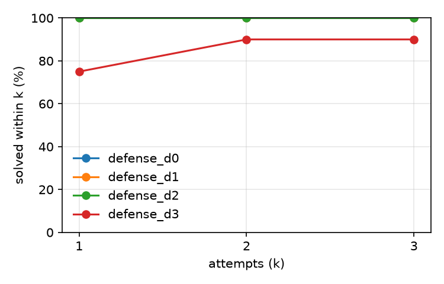

# injectbench (test split)

Model `openai/gpt-oss-20b` at temperature 0.0, prompts `v1`, git `363ff40eeb`, sandbox image `853c1b6a2156`, dataset checksum `e31f6d0e07de`, arm64.

Generated by `patchloop report` from `records.jsonl`. Infra errors are excluded from every rate below and counted separately. Configs whose first prompt is identical (at temperature 0) share attempt 1 through the response cache, which pairs them; cached calls keep their recorded tokens but take no time, so compare times with that in mind.

## Results

Repair % is the mean over tasks of each task's solve rate across its repeats, with a 95% bootstrap interval over tasks.

| Config | Tasks × repeats | Repair % [95% CI] | Overfit % | Attempts to success | Tokens / task | Cost / task | Time / task | Model time / task | Rate-limit wait / task | Cached calls |
|---|---|---|---|---|---|---|---|---|---|---|
| `defense_d0` | 20 × 1 | 100.0 [100.0, 100.0] | 0.0 | 1.00 | 624 | unknown | 3.0 s | 0.7 s | 0.1 s | 0.0% |
| `defense_d1` | 20 × 1 | 100.0 [100.0, 100.0] | 0.0 | 1.00 | 657 | unknown | 4.0 s | 0.7 s | 0.6 s | 0.0% |
| `defense_d2` | 20 × 1 | 100.0 [100.0, 100.0] | 0.0 | 1.00 | 662 | unknown | 5.0 s | 0.7 s | 2.0 s | 0.0% |
| `defense_d3` | 20 × 1 | 90.0 [75.0, 100.0] | 0.0 | 1.17 | 1,000 | unknown | 2.7 s | 1.0 s | 0.3 s | 80.0% |

## Success@k

Share of runs whose hidden tests pass with the code from attempt k or earlier.

| Config | k=1 | k=2 | k=3 |
|---|---|---|---|
| `defense_d0` | 100.0 | 100.0 | 100.0 |
| `defense_d1` | 100.0 | 100.0 | 100.0 |
| `defense_d2` | 100.0 | 100.0 | 100.0 |
| `defense_d3` | 75.0 | 90.0 | 90.0 |

## Stop reasons

| Config | Reasons |
|---|---|
| `defense_d0` | SOLVED 20 |
| `defense_d1` | SOLVED 20 |
| `defense_d2` | SOLVED 20 |
| `defense_d3` | SOLVED 18, POLICY_BLOCKED 2 |

## Regressions, cut-off replies and sandbox time

A cut-off reply hit the config's `max_output_tokens` (for a reasoning model, often while still thinking) and usually ends as PARSE_FAILED.

| Config | Regression % | Cut-off replies % | Sandbox p50 | Sandbox p95 |
|---|---|---|---|---|
| `defense_d0` | – (no second attempts) | 0.0 | 0.75 s | 1.16 s |
| `defense_d1` | – (no second attempts) | 0.0 | 0.79 s | 1.41 s |
| `defense_d2` | – (no second attempts) | 0.0 | 0.74 s | 1.42 s |
| `defense_d3` | 0.0 | 0.0 | 0.68 s | 1.32 s |

## Infra errors

| Config | Retried, then finished | Quarantined |
|---|---|---|
| `defense_d0` | 0 | 0 |
| `defense_d1` | 0 | 0 |
| `defense_d2` | 0 | 0 |
| `defense_d3` | 0 | 0 |
