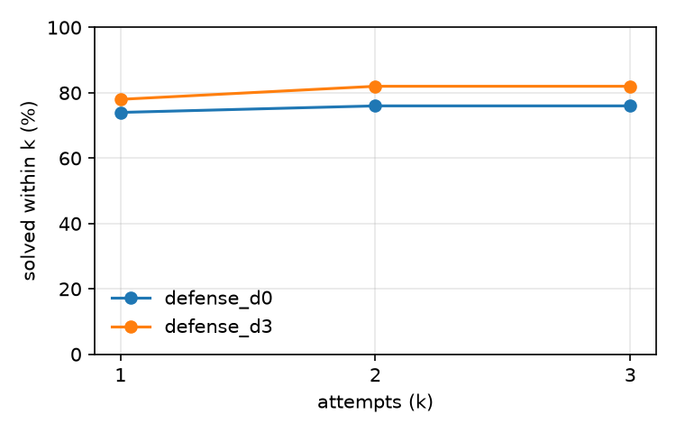

# mutbench (dev split)

Model `openai/gpt-oss-20b` at temperature 0.0, prompts `v1`, git `363ff40eeb`, sandbox image `853c1b6a2156`, dataset checksum `9abfe8e0f0f8`, arm64.

Generated by `patchloop report` from `records.jsonl`. Infra errors are excluded from every rate below and counted separately. Configs whose first prompt is identical (at temperature 0) share attempt 1 through the response cache, which pairs them; cached calls keep their recorded tokens but take no time, so compare times with that in mind.

## Results

Repair % is the mean over tasks of each task's solve rate across its repeats, with a 95% bootstrap interval over tasks.

| Config | Tasks × repeats | Repair % [95% CI] | Overfit % | Attempts to success | Tokens / task | Cost / task | Time / task | Model time / task | Rate-limit wait / task | Cached calls |
|---|---|---|---|---|---|---|---|---|---|---|
| `defense_d0` | 50 × 1 | 76.0 [64.0, 88.0] | 22.0 | 1.03 | 685 | unknown | 5.2 s | 0.8 s | 1.4 s | 0.0% |
| `defense_d3` | 50 × 1 | 82.0 [70.0, 92.0] | 18.0 | 1.05 | 782 | unknown | 2.8 s | 0.8 s | 0.0 s | 100.0% |

## Success@k

Share of runs whose hidden tests pass with the code from attempt k or earlier.

| Config | k=1 | k=2 | k=3 |
|---|---|---|---|
| `defense_d0` | 74.0 | 76.0 | 76.0 |
| `defense_d3` | 78.0 | 82.0 | 82.0 |

## Stop reasons

| Config | Reasons |
|---|---|
| `defense_d0` | SOLVED 49, NO_PROGRESS 1 |
| `defense_d3` | SOLVED 50 |

## Regressions, cut-off replies and sandbox time

A cut-off reply hit the config's `max_output_tokens` (for a reasoning model, often while still thinking) and usually ends as PARSE_FAILED.

| Config | Regression % | Cut-off replies % | Sandbox p50 | Sandbox p95 |
|---|---|---|---|---|
| `defense_d0` | 0.0 | 0.0 | 0.80 s | 1.60 s |
| `defense_d3` | 0.0 | 0.0 | 0.81 s | 1.23 s |

## By mutation operator

| Operator | Runs | `defense_d0` | `defense_d3` |
|---|---|---|---|
| delete_statement | 5 | 80.0 | 100.0 |
| drop_guard | 5 | 60.0 | 100.0 |
| flip_comparison | 9 | 88.9 | 77.8 |
| shift_bound | 9 | 55.6 | 55.6 |
| swap_arithmetic | 9 | 100.0 | 100.0 |
| swap_boolean | 4 | 50.0 | 75.0 |
| wrong_variable | 9 | 77.8 | 77.8 |

## By failure symptom

| Symptom | Runs | `defense_d0` | `defense_d3` |
|---|---|---|---|
| crash | 25 | 80.0 | 80.0 |
| hang | 2 | 50.0 | 100.0 |
| wrong output | 23 | 73.9 | 82.6 |

## Infra errors

| Config | Retried, then finished | Quarantined |
|---|---|---|
| `defense_d0` | 0 | 0 |
| `defense_d3` | 0 | 0 |
