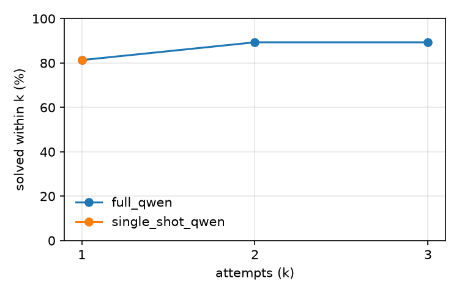

# mutbench (test split)

Model `qwen/qwen3.8-27b` at temperature 0.0, prompts `v1`, git `307dd517cc`, sandbox image `853c1b6a2156`, dataset checksum `9abfe8e0f0f8`, arm64.

Generated by `patchloop report` from `records.jsonl`. Infra errors are excluded from every rate below and counted separately. Configs whose first prompt is identical (at temperature 0) share attempt 1 through the response cache, which pairs them; cached calls keep their recorded tokens but take no time, so compare times with that in mind.

## Results

Repair % is the mean over tasks of each task's solve rate across its repeats, with a 95% bootstrap interval over tasks.

| Config | Tasks × repeats | Repair % [95% CI] | Overfit % | Attempts to success | Tokens / task | Cost / task | Time / task | Model time / task | Rate-limit wait / task | Cached calls |
|---|---|---|---|---|---|---|---|---|---|---|
| `full_qwen` | 150 × 1 | 89.3 [84.0, 94.0] | 8.0 | 1.09 | 781 | unknown | 3.9 s | 0.8 s | 0.9 s | 88.8% |
| `single_shot_qwen` | 150 × 1 | 81.3 [75.3, 87.3] | 8.0 | 1.00 | 647 | unknown | 9.2 s | 0.7 s | 0.3 s | 90.7% |

## Success@k

Share of runs whose hidden tests pass with the code from attempt k or earlier.

| Config | k=1 | k=2 | k=3 |
|---|---|---|---|
| `full_qwen` | 81.3 | 89.3 | 89.3 |
| `single_shot_qwen` | 81.3 | – | – |

## Stop reasons

| Config | Reasons |
|---|---|
| `full_qwen` | SOLVED 146, NO_PROGRESS 2, MAX_ATTEMPTS 2 |
| `single_shot_qwen` | SOLVED 134, MAX_ATTEMPTS 16 |

## Regressions, cut-off replies and sandbox time

A cut-off reply hit the config's `max_output_tokens` (for a reasoning model, often while still thinking) and usually ends as PARSE_FAILED.

| Config | Regression % | Cut-off replies % | Sandbox p50 | Sandbox p95 |
|---|---|---|---|---|
| `full_qwen` | 0.0 | 6.5 | 0.79 s | 1.31 s |
| `single_shot_qwen` | – (no second attempts) | 5.3 | 2.14 s | 5.72 s |

## By mutation operator

| Operator | Runs | `full_qwen` | `single_shot_qwen` |
|---|---|---|---|
| delete_statement | 14 | 78.6 | 71.4 |
| drop_guard | 12 | 75.0 | 58.3 |
| flip_comparison | 28 | 96.4 | 92.9 |
| shift_bound | 28 | 89.3 | 82.1 |
| swap_arithmetic | 28 | 92.9 | 85.7 |
| swap_boolean | 13 | 76.9 | 61.5 |
| wrong_variable | 27 | 96.3 | 88.9 |

## By failure symptom

| Symptom | Runs | `full_qwen` | `single_shot_qwen` |
|---|---|---|---|
| crash | 71 | 90.1 | 84.5 |
| hang | 4 | 75.0 | 50.0 |
| wrong output | 75 | 89.3 | 80.0 |

## Infra errors

| Config | Retried, then finished | Quarantined |
|---|---|---|
| `full_qwen` | 0 | 0 |
| `single_shot_qwen` | 0 | 0 |
