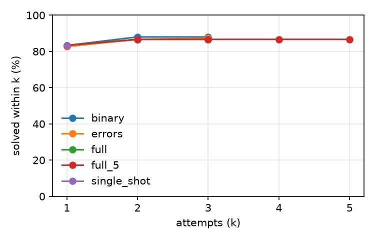

# mutbench (test split)

Model `openai/gpt-oss-20b` at temperature 0.0, prompts `v1`, git `0e2fd958c3`, sandbox image `853c1b6a2156`, dataset checksum `9abfe8e0f0f8`, arm64.

Generated by `patchloop report` from `records.jsonl`. Infra errors are excluded from every rate below and counted separately. Configs whose first prompt is identical (at temperature 0) share attempt 1 through the response cache, which pairs them; cached calls keep their recorded tokens but take no time, so compare times with that in mind.

## Results

Repair % is the mean over tasks of each task's solve rate across its repeats, with a 95% bootstrap interval over tasks.

| Config | Tasks × repeats | Repair % [95% CI] | Overfit % | Attempts to success | Tokens / task | Cost / task | Time / task | Model time / task | Rate-limit wait / task | Cached calls |
|---|---|---|---|---|---|---|---|---|---|---|
| `binary` | 150 × 1 | 88.0 [82.7, 92.7] | 11.3 | 1.05 | 814 | unknown | 2.6 s | 0.9 s | 0.0 s | 93.8% |
| `errors` | 150 × 1 | 87.3 [82.0, 92.7] | 12.7 | 1.06 | 830 | unknown | 3.2 s | 0.9 s | 0.0 s | 93.8% |
| `full` | 150 × 1 | 86.7 [81.3, 92.0] | 12.0 | 1.04 | 816 | unknown | 1.6 s | 0.9 s | 0.0 s | 93.8% |
| `full_5` | 150 × 1 | 86.7 [81.3, 92.0] | 12.0 | 1.04 | 816 | unknown | 3.0 s | 0.9 s | 0.0 s | 100.0% |
| `single_shot` | 150 × 1 | 83.3 [77.3, 89.3] | 11.3 | 1.00 | 700 | unknown | 4.0 s | 0.8 s | 1.1 s | 0.0% |

## Comparisons

Paired over the tasks both configs finished: the difference in per-task solve rate (b − a, in points) with a 95% bootstrap interval. An interval that includes zero is reported as no clear difference.

| a | b | Tasks | b − a [95% CI] | Verdict |
|---|---|---|---|---|
| `single_shot` | `full` | 150 | +3.3 [+0.7, +6.7] | `full` better |
| `binary` | `full` | 150 | -1.3 [-3.3, +0.0] | no clear difference |
| `errors` | `full` | 150 | -0.7 [-2.0, +0.0] | no clear difference |
| `single_shot` | `binary` | 150 | +4.7 [+1.3, +8.0] | `binary` better |

## Success@k

Share of runs whose hidden tests pass with the code from attempt k or earlier.

| Config | k=1 | k=2 | k=3 | k=4 | k=5 |
|---|---|---|---|---|---|
| `binary` | 83.3 | 88.0 | 88.0 | – | – |
| `errors` | 82.7 | 86.7 | 87.3 | – | – |
| `full` | 83.3 | 86.7 | 86.7 | – | – |
| `full_5` | 83.3 | 86.7 | 86.7 | 86.7 | 86.7 |
| `single_shot` | 83.3 | – | – | – | – |

## Stop reasons

| Config | Reasons |
|---|---|
| `binary` | SOLVED 147, NO_PROGRESS 3 |
| `errors` | SOLVED 149, NO_PROGRESS 1 |
| `full` | SOLVED 146, NO_PROGRESS 4 |
| `full_5` | SOLVED 146, NO_PROGRESS 4 |
| `single_shot` | SOLVED 140, MAX_ATTEMPTS 10 |

## Regressions, cut-off replies and sandbox time

A cut-off reply hit the config's `max_output_tokens` (for a reasoning model, often while still thinking) and usually ends as PARSE_FAILED.

| Config | Regression % | Cut-off replies % | Sandbox p50 | Sandbox p95 |
|---|---|---|---|---|
| `binary` | 0.0 | 0.0 | 0.60 s | 1.71 s |
| `errors` | 0.0 | 0.6 | 0.84 s | 1.52 s |
| `full` | 18.2 | 0.0 | 0.40 s | 0.51 s |
| `full_5` | 18.2 | 0.0 | 0.86 s | 1.46 s |
| `single_shot` | – (no second attempts) | 0.0 | 0.57 s | 1.18 s |

## By mutation operator

| Operator | Runs | `binary` | `errors` | `full` | `full_5` | `single_shot` |
|---|---|---|---|---|---|---|
| delete_statement | 14 | 85.7 | 85.7 | 78.6 | 78.6 | 78.6 |
| drop_guard | 12 | 83.3 | 83.3 | 83.3 | 83.3 | 83.3 |
| flip_comparison | 28 | 96.4 | 96.4 | 96.4 | 96.4 | 96.4 |
| shift_bound | 28 | 85.7 | 85.7 | 85.7 | 85.7 | 85.7 |
| swap_arithmetic | 28 | 92.9 | 92.9 | 92.9 | 92.9 | 78.6 |
| swap_boolean | 13 | 76.9 | 69.2 | 69.2 | 69.2 | 61.5 |
| wrong_variable | 27 | 85.2 | 85.2 | 85.2 | 85.2 | 85.2 |

## By failure symptom

| Symptom | Runs | `binary` | `errors` | `full` | `full_5` | `single_shot` |
|---|---|---|---|---|---|---|
| crash | 71 | 91.5 | 91.5 | 91.5 | 91.5 | 85.9 |
| hang | 4 | 100.0 | 100.0 | 100.0 | 100.0 | 100.0 |
| wrong output | 75 | 84.0 | 82.7 | 81.3 | 81.3 | 80.0 |

## Infra errors

| Config | Retried, then finished | Quarantined |
|---|---|---|
| `binary` | 0 | 0 |
| `errors` | 0 | 0 |
| `full` | 0 | 0 |
| `full_5` | 0 | 0 |
| `single_shot` | 0 | 0 |
